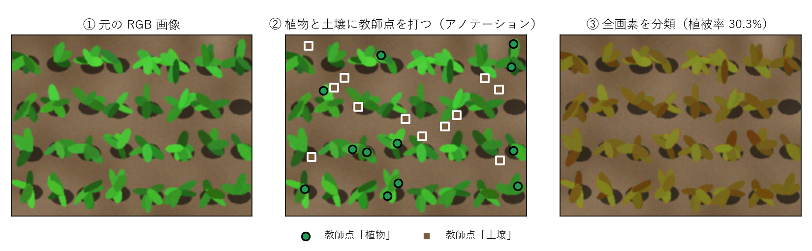

# adaptFVC

English | [日本語](README_ja.md)

adaptFVC is an application for calculating fractional vegetation cover (FVC) from visible-light (RGB) images of crop canopies.
With adaptFVC, you can easily build your own machine-learning classification model and process many images at once.
We recommend building a separate model for each set of images taken in the same field, on the same day, with the same camera.



You click plant pixels and soil pixels on a few images.
adaptFVC trains a Random Forest classifier on the colour of those pixels and then labels every pixel of every image in the folder as plant or soil.

adaptFVC runs on Windows. The user interface and the user manual are currently available only in Japanese.
If you would like an English version, please let us know by opening an [issue](https://github.com/KotaNakajima/adaptFVC/issues).

## Quick start

1. Put the images taken in the same field, on the same day, with the same camera into one folder (manual section 2.1).
2. Start `adaptFVC.exe` and choose that folder (2.2).
3. Press Q (plant) or W (soil) and click on the image to place training points (2.3 and 2.4).
4. Press T to train. Move between images with A and D to check the result, add training points where pixels are misclassified, and press T again (2.5).
5. Use the preview to check images that were not used for training (2.5).
6. Click the button for processing all images (全画像を処理) and look at the result images before you use the numbers (2.6 and chapter 4).

## Features

- You place training points by clicking plant and soil pixels (keys Q and W). Consecutive clicks of the same class can also add the pixels on the line between them. The numbers of clicks and of registered pixels are shown for each class.
- Pixels are classified by a Random Forest (200 trees, random seed 42) on their three CIELAB colour values. The same training points always give the same model.
- The prediction can be shown over the image and switched on and off with Space. When you move to another image, the prediction for that image is shown automatically.
- Before you process the whole folder, the preview shows the result on images that are not in the list of training images.
- All images in the folder are processed on multiple CPU cores. adaptFVC writes an Excel report with the FVC and the fraction of valid pixels of each image, and a result image for each input image.
- Transparent pixels (alpha below 128) are excluded from both the FVC denominator and the training data, so plots clipped from an orthomosaic can be used as they are.
- When you open a folder with large images for the first time, adaptFVC asks for a size (long side 1024, 512, or 256 px) and makes downscaled copies once. All later display, training, and processing use these copies, which makes the work faster with only a small change in FVC (manual section 2.2). The choice is remembered for each folder, and the original images are not changed.
- Training points and models are saved automatically and can be restored when you open the folder again. If the training points have changed since the last training, adaptFVC asks you to retrain before processing all images, so the saved training points always reproduce the model that was used.
- adaptFVC never connects to the internet. All output goes to an `adaptFVC/` folder inside the image folder.

Supported image formats are JPEG, PNG, and 8-bit TIFF. Geographic information in GeoTIFF files is not read.

## Output

```
<image folder>/adaptFVC/
   cache/               downscaled copies of the images
   models/              model_latest.pkl, annotations_latest.json, history/
   results/run_<date>_<time>/
                        vegetation_coverage_<date>_<time>.xlsx   FVC of each image
                        overlays/                               result images
                        model_<date>_<time>.pkl                 the model used
                        annotations_<date>_<time>.json          its training points
                        run_metadata.json                       versions and settings
   previews/            preview results
   logs/                work log (never sent anywhere)
```

## Before you trust the numbers

- Always look at the result images, for example a few bright and a few dark images from each date. Check that shadows are not labelled as plants and that bright leaves are not labelled as soil.
- Do not reuse a model for images taken on another date, in another field, or with another camera. Build a new model for each set of images.
- If a value looks strange, suspect the training points or a mixed set of images before treating it as a finding.

## Installation

### Windows executable

Download `adaptFVC_v<version>_win64.zip` from the [Releases](https://github.com/KotaNakajima/adaptFVC/releases) page, unzip it, and run `adaptFVC.exe`. No installation is needed.
The executable is not code-signed, so Windows SmartScreen may show a warning on the first start. Click "More info" and then "Run anyway".
It has been tested on 64-bit Windows 11.

### From source

Python 3.12 is required (tested with 3.12.6).

```
python -m venv .venv
.venv\Scripts\pip install -r requirements-app.txt
.venv\Scripts\python adaptFVC.py
```

`python -m adaptfvc` starts the same application.

### Building the executable

Building, tests, regenerating the figures of the manual, and the command-line batch mode are described in `BUILD.md` (in Japanese). The short version for building on Windows is below.

```
.venv\Scripts\pip install pyinstaller==6.19.0
.venv\Scripts\pyinstaller build.spec --noconfirm --clean
```

The executable is written to `dist\adaptFVC.exe`.
A macOS build script (`build_mac.sh`) is included but has not yet been tested on a Mac.

## Documentation

The user manual is in Japanese, in `docs/adaptFVC_manual_ja.pdf` (HTML source in `docs/manual.html`).
It has two parts. Part 1 covers operation, output, and checking the results. Part 2 explains the method, the design choices, reproducibility, and how to cite the software.

## License

Copyright (C) 2026 Kota Nakajima

adaptFVC is free software: you can redistribute it and/or modify it under the terms of the GNU General Public License as published by the Free Software Foundation, either version 3 of the License, or (at your option) any later version.
It is distributed in the hope that it will be useful, but WITHOUT ANY WARRANTY; without even the implied warranty of MERCHANTABILITY or FITNESS FOR A PARTICULAR PURPOSE. See `LICENSE` for the full text.

The Windows executable also contains third-party libraries. Their licenses are collected in `THIRD_PARTY_LICENSES.txt` in the release archive.

## Citation

If you use adaptFVC, please cite it with the metadata in `CITATION.cff` (GitHub shows it as "Cite this repository"). A DOI will be added after the first archived release.

For the methods section, report at least the version of adaptFVC, the downscaling size, the unit for which each model was built (for example, each imaging date), and the scikit-learn version recorded in `run_metadata.json`. The classifier settings (Random Forest with 200 trees, random seed 42, CIELAB features) are fixed.
To make the results reproducible, please also share the training-point file (`annotations_<date>_<time>.json` in the result folder) as supplementary material. The same model can be rebuilt from this file. Chapter 11 of the manual gives an example sentence.
