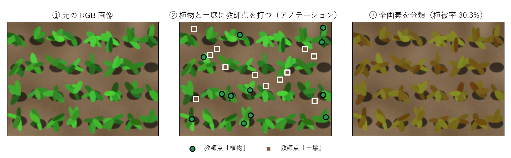

# adaptFVC

[English](README.md) | 日本語

adaptFVC は、作物群落を撮影した可視画像から植被率を計算するためのアプリです。機械学習に基づく分類モデルを手軽に自分で構築し、多くの画像を一括で処理することができます。分類モデルは、同一圃場・同一日・同一カメラ由来の画像セットごとに構築することをお勧めします。



利用者が、数枚の画像の上で植物と土壌の画素をクリックします。adaptFVC はその画素の色から Random Forest の分類モデルを学習し、フォルダ内のすべての画像の全画素を植物と土壌に振り分けます。

Windows 用のアプリで、画面と取扱説明書は日本語です。

## 最短手順

1. 同一圃場・同一日・同一カメラの画像を、1つのフォルダにまとめます（取扱説明書 2.1節）。
2. `adaptFVC.exe` を起動し、そのフォルダを選びます（2.2節）。
3. Q（植物）と W（土壌）を切り替えながら、画像をクリックして教師点を打ちます（2.3節・2.4節）。
4. T で学習し、A / D で画像を切り替えて判定を確かめます。誤分類の箇所に教師点を足して、もう一度 T を押します（2.5節）。
5. プレビューで、学習に用いていない画像でも正しいかを確かめます（2.5節）。
6. 「全画像を処理」を押し、数字を使う前に判定画像を目で確かめます（2.6節・第4章）。

## 主な機能

- 植物と土壌の画素をクリックして教師点を打ちます（Q / W キー）。同じクラスで続けてクリックすると、間の直線上の画素も教師点になります（連続注釈）。クラスごとのクリック数と画素数が表示されます。
- 画素は、CIELAB の3つの色の値を使う Random Forest（決定木 200 本、乱数のシード値 42）で分類されます。同じ教師点からは、いつも同じモデルができます。
- 判定結果を画像に重ねて表示し、Space で表示を切り替えられます。別の画像に移ると、その画像の判定が自動で表示されます。
- 全画像を処理する前に、学習用の画像の列に入っていない画像で判定を確かめられます（プレビュー）。
- フォルダ内の全画像を、複数の CPU コアで並列に処理します。画像ごとの植被率と有効画素率を Excel に、判定画像を1枚ずつ出力します。
- 透明な画素（アルファ 128 未満）は、植被率の分母からも学習データからも除きます。オルソ画像から切り出したプロットの画像を、そのまま使えます。
- 大きな画像の入ったフォルダを初めて開くと、縮小サイズ（長辺 1024 / 512 / 256 px）を聞かれ、縮小版を一度だけ作ります。以後の表示・学習・処理はすべて縮小版で行うので作業が速くなり、植被率の変化はわずかです（取扱説明書 2.2節）。選択はフォルダごとに記憶され、元の画像は変更しません。
- 教師点とモデルは自動で保存され、同じフォルダを開き直すと復元できます。学習のあとに教師点を変えていた場合は、全画像を処理する前に学習し直すかを聞きます。保存される教師点からは、処理に使ったモデルを必ず作り直せます。
- インターネットへの通信は一切しません。出力はすべて画像フォルダ内の `adaptFVC/` に保存します。

対応する画像の形式は JPEG・PNG・8 bit TIFF です。GeoTIFF の地理情報は読みません。

## 出力

```
<画像フォルダ>/adaptFVC/
   cache/               縮小版のキャッシュ
   models/              model_latest.pkl / annotations_latest.json / history/
   results/run_<日時>/
                        vegetation_coverage_<日時>.xlsx   画像ごとの植被率
                        overlays/                        判定画像
                        model_<日時>.pkl                 処理に使ったモデル
                        annotations_<日時>.json          その教師点
                        run_metadata.json                版と設定の記録
   previews/            プレビューの結果
   logs/                作業ログ（送信はされない）
```

## 結果を信じる前に

- 判定画像を必ず目視してください。撮影日ごとに、明るい画像と暗い画像から数枚ずつ選び、影が植物に、白飛びした葉が土壌になっていないかを確かめます。
- モデルを、撮影日・圃場・カメラの違う画像に使い回さないでください。画像セットごとにモデルを作ります。
- おかしな値が出たら、発見と考える前に、教師点の誤りや撮影条件の混入を疑ってください。

## 入手と起動

### Windows 用の実行ファイル

[Releases](https://github.com/KotaNakajima/adaptFVC/releases) のページから `adaptFVC_v<版>_win64.zip` を入手して展開し、`adaptFVC.exe` を起動します。インストールは不要です。
コード署名をしていないので、初回の起動時に Windows SmartScreen の警告が出ることがあります。その場合は「詳細情報」→「実行」を押してください。
64 bit 版の Windows 11 で動作を確認しています。

### ソースコードから

Python 3.12 が必要です（3.12.6 で確認）。

```
python -m venv .venv
.venv\Scripts\pip install -r requirements-app.txt
.venv\Scripts\python adaptFVC.py
```

`python -m adaptfvc` でも同じアプリが起動します。

### 実行ファイルを作る

実行ファイルの作り方、テスト、取扱説明書の図の作り直し、画面を開かない処理は `BUILD.md` にまとめています。Windows で実行ファイルを作る要点は次のとおりです。

```
.venv\Scripts\pip install pyinstaller==6.19.0
.venv\Scripts\pyinstaller build.spec --noconfirm --clean
```

実行ファイルは `dist\adaptFVC.exe` にできます。
macOS 用の作成スクリプト（`build_mac.sh`）も同梱していますが、Mac での動作はまだ確認していません。

## 取扱説明書

取扱説明書は `docs/adaptFVC_manual_ja.pdf` です（元の HTML は `docs/manual.html`）。
2部構成で、第1部「使う」は操作の手順・出力・結果の確かめ方、第2部「理解する・記録する」は原理・設計の考え方・再現性・引用のしかたです。

## ライセンス

Copyright (C) 2026 Kota Nakajima

adaptFVC はフリーソフトウェアです。GNU General Public License（バージョン3、またはそれ以降の任意の版）の条件のもとで、再配布・改変できます。無保証です。詳しくは `LICENSE`（英語の原文）を参照してください。

Windows 用の実行ファイルには他のライブラリも同梱しています。それらのライセンスは、配布 zip の `THIRD_PARTY_LICENSES.txt` にまとめています。

## 引用

adaptFVC を使った場合は、`CITATION.cff` の情報で引用してください（GitHub のページでは「Cite this repository」として表示されます）。DOI は、最初のリリースを Zenodo に保存したあとに記載します。

方法の節には、少なくとも次を書いてください: adaptFVC の版、縮小サイズ、モデルを作った単位（例: 撮影日ごと）、`run_metadata.json` に記録された scikit-learn の版。分類器の設定（Random Forest、決定木 200 本、乱数のシード値 42、CIELAB の特徴量）は固定です。
結果を再現できるように、教師点のファイル（結果フォルダの `annotations_<日時>.json`）を補足資料として公開してください。このファイルから同じモデルを作り直せます。書き方の例は取扱説明書の第11章にあります。
